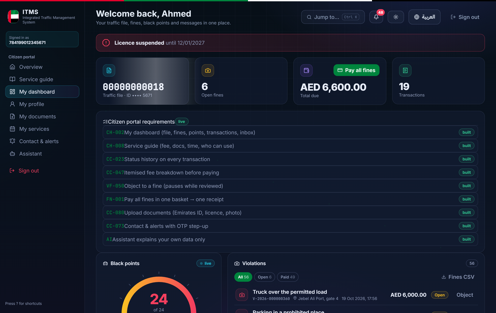
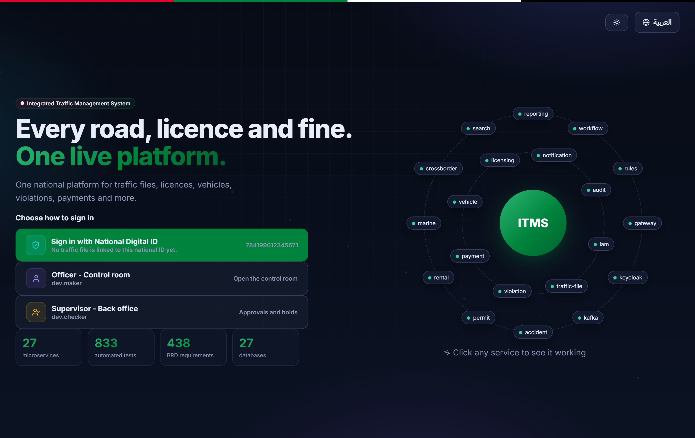
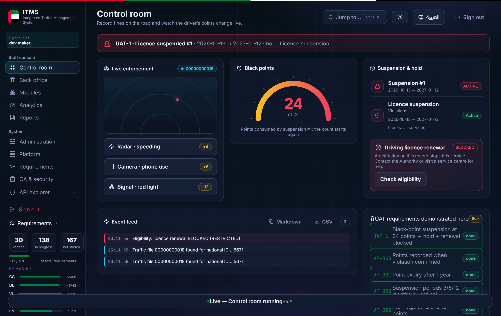
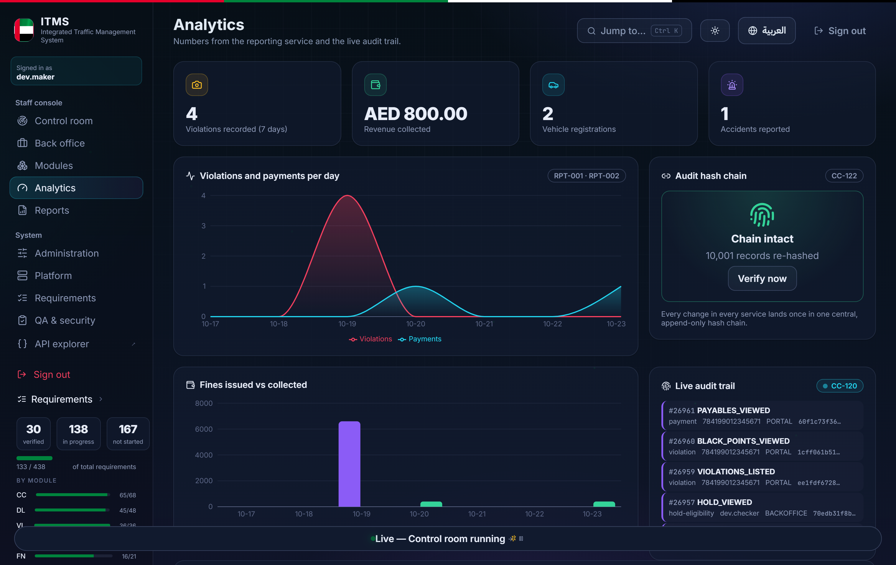
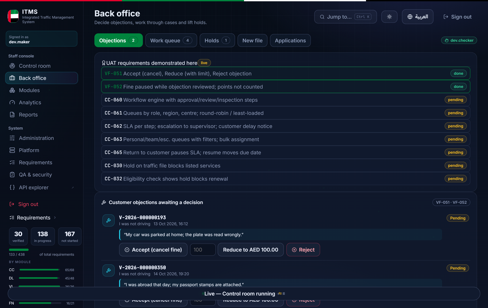
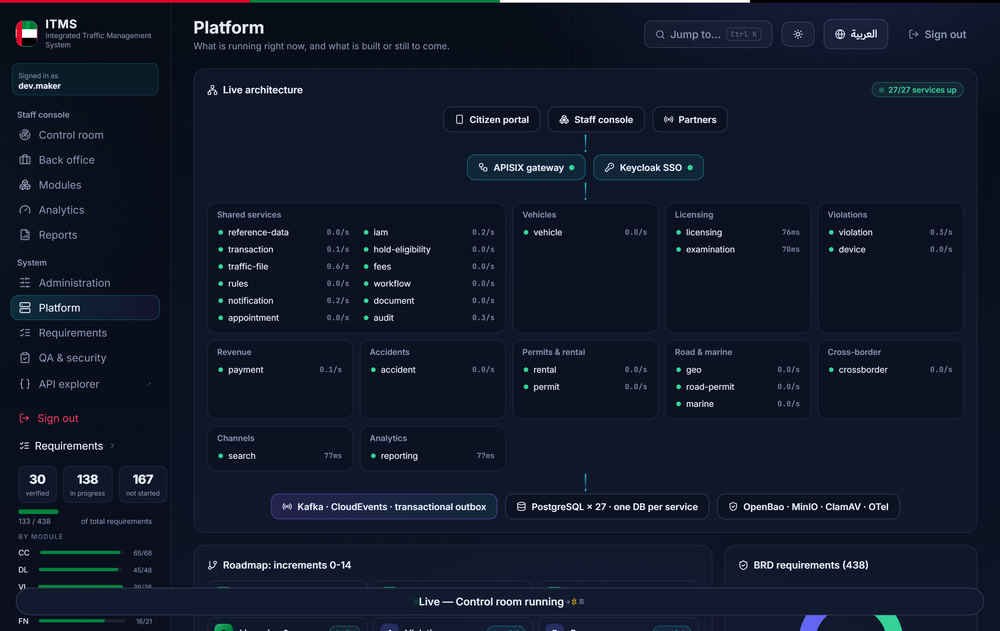

# Integrated Traffic Management System (ITMS)

**A national-scale vehicle, licensing and traffic-violation management platform — the way a modern traffic authority would run it.**

> Built as a from-scratch engineering showcase: clustering 26 microservices, a React citizen/staff portal, event-driven payment and violation flows, and full audit and security tooling — everything that a production civil-service system requires.

<p align="center">
  
</p>

---

## What is this?

ITMS simulates the core work of a traffic authority. A citizen signs in with the **national digital ID** and sees their traffic file: vehicles, driving licence, fines, black points and messages. A staff member signs in separately and works in a **control room and back office**: recording violations, deciding objections, managing cases, watching live KPIs.

It is not a mock-up: the demo portal calls **real microservice APIs through a real API gateway** — payments complete through a partner mock and issue a receipt, violations move black-point accounts live, reaching suspensions at the legal thresholds.

### For the public (citizens)

| | |
|---|---|
| 🚗 **Traffic file in one place** | Vehicles, plates, licences, documents — all viewable with document upload and status tracking. |
| 💳 **Pay fines your way** | A basket to pay all fines at once or in **instalment plans**, through a hosted partner payment gateway, with a verifiable receipt at the end. |
| ⚖️ **Object to a violation** | Submit an objection with evidence and track the officer decision. |
| 🏥 **Book a service-centre visit** | Real availability calendars, confirmation flow, and **queue tickets** with live centre-queue numbering. |
| 🤖 **Ask the assistant** | An in-portal helper that answers questions about *your own* fines and points only — reading strictly the APIs your session is allowed to use. |
| 🔍 **Verify certificates** | Any issued certificate can be verified by QR/number. |
| 🇦🇪🇬🇧 Arabic and English | Full RTL/LTR interface, language switchable at run time. |

### For the authority (staff)

| | |
|---|---|
| 🛰️ **Control room** | Record a roadside violation and watch the driver's black points change **live** — culminating in suspension and a hold at 24 points. |
| 🗂️ **Back office** | Work objections and applications in queues, lift holds, manage cases with maker-checker approvals. |
| 📊 **Analytics & reports** | Warehouse-backed KPI charts with configurable targets and red/amber/green thresholds, live audit feed, CSV report downloads. |
| 🧾 **Audit by default** | Every change is audited (who, role, channel, IP, before/after, reason) into a central **hash-chained** audit service — no silent edits, ever. |
| 🥅 **Requirement traceability** | Every feature is traceable to a numbered requirement with test evidence — 800+ automated tests across the suite. |

---

## Screens

| Sign-in | Citizen dashboard |
|---|---|
|  |  |

| Control room (staff) | Analytics (KPI + live audit) |
|---|---|
|  |  |

| Back office | Platform / engineering |
|---|---|
|  |  |

---

## How it is built

**Domain-driven microservices, one database per service, event-coupled through a transactional outbox.**

| Layer | Technology |
|---|---|
| Services | Java 21, Spring Boot (MVC, Security, JDBC, Kafka, virtual threads), Maven multi-module (29 modules) |
| Data | PostgreSQL 17 — **one database per service**, Flyway migrations, plain JDBC |
| Inter-service | Kafka 4.2 with a **transactional outbox** (CloudEvents envelopes) |
| Gateway | Apache APISIX — single front door, one route map, no CORS coupling |
| Identity | Keycloak for authentication only; authorisation (scopes, delegation, maker-checker limits) is owned by `iam-service` |
| Secrets | OpenBao issues every service a **short-lived, rotated** database login — no static DB passwords anywhere |
| Front end | React + TypeScript portal (dark control-centre theme, RTL/LTR, charts) |
| Observability | OpenTelemetry collector + Prometheus, Tempo, Loki, Grafana; health and metrics per service |
| Shared platform | `platform/itms-platform`: security & data scopes, audit outbox, idempotency filter, problem+json errors, service clients |
| Quality gates | OpenAPI 3.1 linting per service, JUnit 5 + Testcontainers + ArchUnit, JaCoCo ≥ 80%, SpotBugs + FindSecBugs, gitleaks, Dependency-Check, SBOM |

The commerce-critical flows mirror production semantics: **registration checks insurance before quoting a fee**, payment callbacks are idempotent (**one receipt, repeats logged as duplicates**), and a 24-black-point driver is suspended and held exactly per the rules.

## Repository map

```
services/            One Maven service per domain (vehicle, violation, payment, iam, traffic-file,
                     licensing, examination, appointment, reporting, search, ai, migration, ...)
platform/itms-platform/   Shared security, audit, outbox, idempotency and observability library
demo/portal/         The React/TypeScript showcase portal (citizen + staff + system pages)
infra/local/         Docker Compose stack for the complete local environment
tools/               dev scripts (up.sh, smoke.sh, demo-seed.sh), CI verify scripts, traceability verifier
```

## Run it locally

```bash
# 1. Start the whole stack (24 Postgres DBs, gateway, Keycloak, observability, ...)
ITMS_LOCAL_PROFILE=lite tools/dev/up.sh

# 2. Seed demo data through the public APIs only
tools/dev/demo-seed.sh

# 3. Run the showcase portal
cd demo/portal && npm install && npm run dev   # → http://localhost:5173
```

OpenAPI contract files live in `services/<svc>/src/main/resources/openapi/` — with a linting pipeline to keep them clean.

---

## A note on confidentiality

This repository is the engineering showcase. The underlying functional specification (the traffic authority's business-requirements documentation) is **confidential under a non-disclosure agreement and is not part of this repository**; requirement IDs are referenced in code as traceability markers only.

All data in the local/demo environment is **synthetic** — no real citizen, vehicle or payment information exists anywhere in the codebase.
